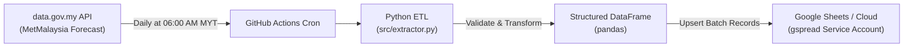

# Perasaan Malaysia ⛅🇲🇾

[](https://github.com/Downey112/perasaan-malaysia/actions/workflows/perasaan_sync.yml)
[](https://www.python.org/)
[](https://data.gov.my)
[](https://developers.google.com/sheets/api)

An automated daily ETL pipeline that ingests 7-day weather forecasts across Malaysian states and districts from the official **MetMalaysia open data API (`data.gov.my`)** and synchronizes structured records into Google Sheets for downstream reporting.

---

## ⚡ Architecture & Automation



* **Orchestration:** GitHub Actions scheduled cron job (`.github/workflows/perasaan_sync.yml`) runs automatically every morning at 06:00 AM MYT (22:00 UTC), plus manual trigger support (`workflow_dispatch`).
* **Ingestion:** Queries the official government weather endpoint (`https://api.data.gov.my/weather/forecast`), parsing multi-level location hierarchies (State `St` and District `Ds`).
* **Transformation:** Flattens JSON payloads into standardized relational records (morning/afternoon/night weather summaries, min/max temperatures, date tokens).
* **Storage & Access:** Authenticates using Google Cloud Service Account credentials (`gspread`) to cleanly refresh the reporting worksheet.

---

## 📊 Extracted Schema

| Field | Type | Description |
|---|---|---|
| `Extraction_Date` | Date (`YYYY-MM-DD`) | Timestamp when the ETL job ran |
| `Location_ID` | String | Official administrative identifier (`St*` for State, `Ds*` for District) |
| `Location_Name` | String | Name of the state or district |
| `Location_Type` | Categorical | `State` or `District` |
| `Forecast_Date` | Date (`YYYY-MM-DD`) | Target forecast date |
| `Morning_Forecast` | String | Weather forecast for morning window |
| `Afternoon_Forecast` | String | Weather forecast for afternoon window |
| `Night_Forecast` | String | Weather forecast for evening/night window |
| `Summary_Forecast` | String | Consolidated daily weather classification |
| `Min_Temp_C` | Float | Forecasted minimum temperature (°C) |
| `Max_Temp_C` | Float | Forecasted maximum temperature (°C) |

---

## 🛠️ Local Development & Setup

### 1. Clone & Set Up Environment
```bash
git clone https://github.com/Downey112/perasaan-malaysia.git
cd perasaan-malaysia

python -m venv .venv
source .venv/bin/activate  # On Windows: .venv\Scripts\activate
pip install -r requirements.txt
```

### 2. Configure Service Account Credentials
Place your Google Cloud Service Account JSON file as `credentials.json` in the root directory (already excluded via `.gitignore`), or export it to the environment:
```bash
export GCP_SA_KEY='{"type": "service_account", ...}'
```

### 3. Run Pipeline Manually
```bash
python src/extractor.py
```
